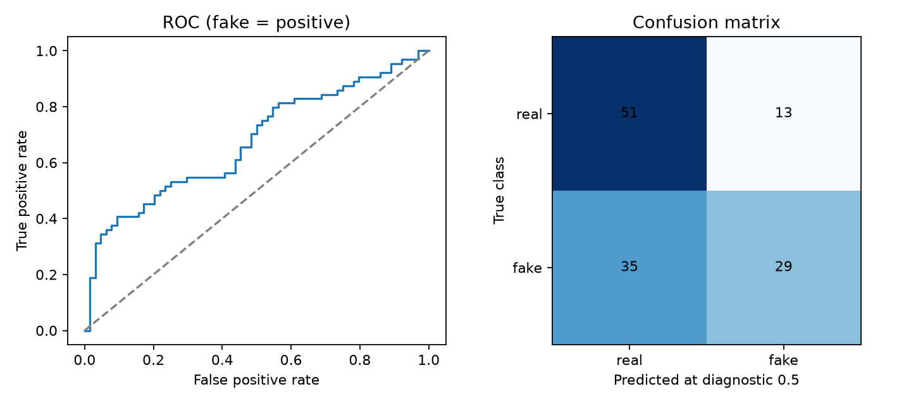
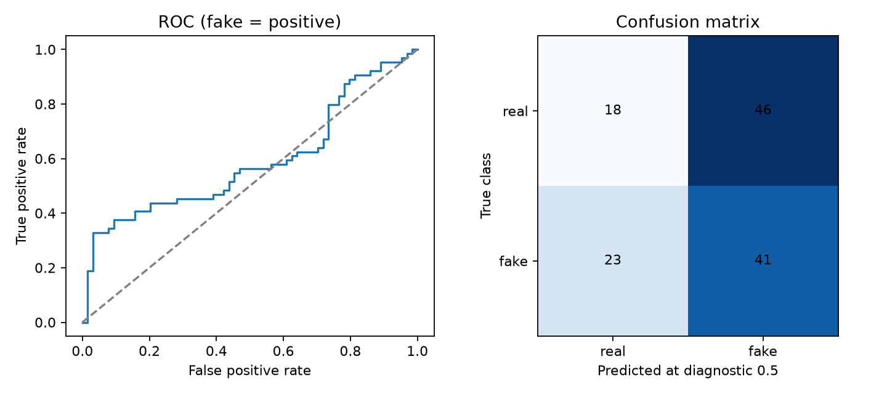

# Exploratory Arabic results — 20 October 2026

Follow-up: [a separate trained-head experiment](model-improvement/README.md)
improved matched accuracy from 54.69% to 71.88% on a **different fresh 256-clip
subset**. The historical 128-clip results below remain unchanged. For the opt-in
profile see [Windows instructions](../ARABIC_PROFILE.md).

These are real inference measurements on a small public dataset subset, not
software-test fixtures and not a completed consented, speaker-disjoint study.
No audio is redistributed here.

Source: [ArAD by DeepFake-Audio-Rangers](https://huggingface.co/datasets/DeepFake-Audio-Rangers/Arabic_Audio_Deepfake),
stated license [ODC-By-1.0](https://opendatacommons.org/licenses/by/1-0/).
Pinned dataset revision: `9dbe1c09acc5907741dcd8c64d7a1d092ff1886d`.
Model: `garystafford/wav2vec2-deepfake-voice-detector`, revision
`c66306024a7ede0be291e9c4558b37634782dc4e`.

## Current model: 128 clips

Selection: 64 publisher-labeled real and 64 fake clips from the publisher's test
partition, seed 20261020, without selecting on detector scores. Exact byte
content was checked for duplicates before sampling; none were found. Source
checksum and selected clip indices/checksums are in [the raw report](arad-base.json).

| Metric | Result |
|---|---:|
| Accuracy at diagnostic 0.5 | 62.50% |
| Fake precision | 69.05% |
| Fake recall | 45.31% |
| F1 | 54.72% |
| ROC AUC | 0.6741 |
| Interpolated EER | 43.75% |

Confusion matrix (rows true real/fake; columns predicted real/fake):
`[[51, 13], [35, 29]]`. Of 64 labeled fakes, 35 were missed at 0.5. This does
not support a claim of reliable Arabic deepfake detection.

The speech gate rejected 3 publisher-labeled real clips and 2 fake clips.
Classifier metrics above include all 128 clips before that gate; they are not
end-to-end API decision metrics. No thresholds have been fitted or installed.



## Paired digital robustness: 32 clips

A fixed balanced subset of 16 clips per class was selected before inference.
Compare each condition to **its 32-clip original baseline**, not the 128-clip
accuracy above. Noise is seeded per audio checksum. Each changed clip is scored
with the same model and aggregation.

| Condition | Accuracy | EER |
|---|---:|---:|
| original | 59.38% | 56.25% |
| resampled_8khz | 56.25% | 43.75% |
| noise_20db | 50.00% | 68.75% |
| noise_10db | 50.00% | 68.75% |
| mp3_32kbps | 56.25% | 43.75% |

The model was sensitive to added noise on this small subset. Sample size and
unknown speaker overlap prevent population-level conclusions. Changes in EER
and accuracy need not move together: accuracy uses fixed 0.5, while EER is a
ranking/threshold diagnostic. Physical loudspeaker re-recording is **not run**.

## Two-model comparison on the same 128 clips

The optional second model is `mo-thecreator/Deepfake-audio-detection`, pinned to
`e4d9874b493362149cec96ced85f00b00b1a04c0`. The ensemble averages the two models'
fake scores. Source checksum, selected clip hashes and labels were checked to
match the baseline exactly. See [the raw ensemble report](arad-ensemble.json).

| Metric at diagnostic 0.5 | Current single model | Two-model average |
|---|---:|---:|
| Accuracy | 62.50% | 46.09% |
| Fake precision | 69.05% | 47.13% |
| Fake recall | 45.31% | 64.06% |
| F1 | 54.72% | 54.30% |
| ROC AUC | 0.6741 | 0.5894 |
| Interpolated EER | 43.75% | 45.31% |

The ensemble confusion matrix is `[[18, 46], [23, 41]]`. The models disagree at
the diagnostic 0.5 boundary on 53/128 clips. These aggregate metrics evaluate
raw averaged scores **before abstention**, not production ensemble decisions.
An uncalibrated API abstains; a calibrated ensemble also abstains on model
disagreement. No production ensemble coverage or calibrated accuracy is claimed.
This run does not support ensemble superiority; the application default remains
unchanged. The test subset must not now be reused to fit decision thresholds.



To repeat this comparison in a shell that supports environment assignments:

```sh
VG_SECOND_MODEL=mo-thecreator/Deepfake-audio-detection \
VG_SECOND_REVISION=e4d9874b493362149cec96ced85f00b00b1a04c0 \
python public_arabic_benchmark.py --robustness-per-class 0 --output reports/arad-ensemble.json
```

## Limits and remaining work

The publisher provides no speaker IDs or individual consent records. Speaker
independence, original utterance overlap, detector training overlap and label
correctness are unverified. The card describes mainly Levantine Arabic,
RVC-generated fakes and short cleaned clips; this does not establish performance
for all Arabic dialects, generators, long audio or phone recordings.

A consented dataset with speaker-disjoint training/validation/test partitions is
still needed for threshold calibration and optional Arabic fine-tuning. Your
exact silent microphone clip is still needed to reproduce the screenshot issue.
Do not treat the app's displayed model score as a probability of authenticity.

To reproduce, install `requirements-research.txt` and run
`python public_arabic_benchmark.py`. See
[the experiment instructions](../FINISHING_EXPERIMENTS.md).

Software verification after adding this workflow: 45 Python tests passed; the
research requirements audit found no known vulnerabilities, and the new script
had no medium/high Bandit findings. The final model-comparison path was also
executed against the actual pinned models and dataset.
