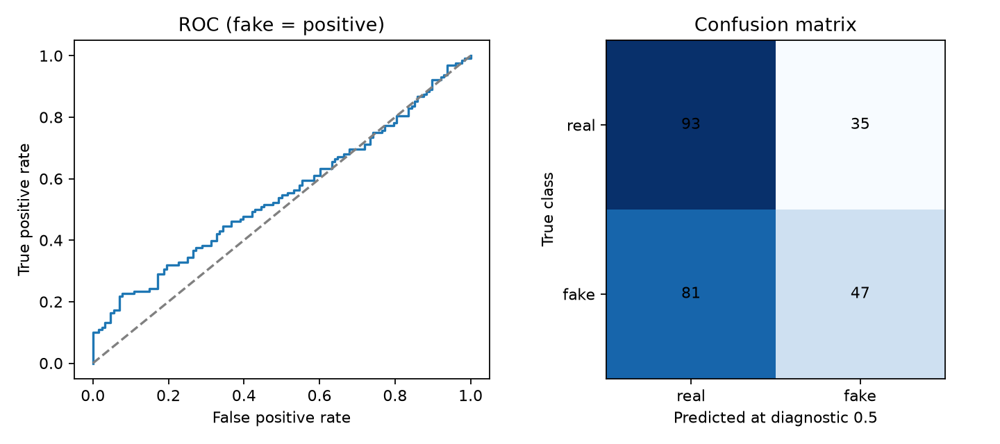
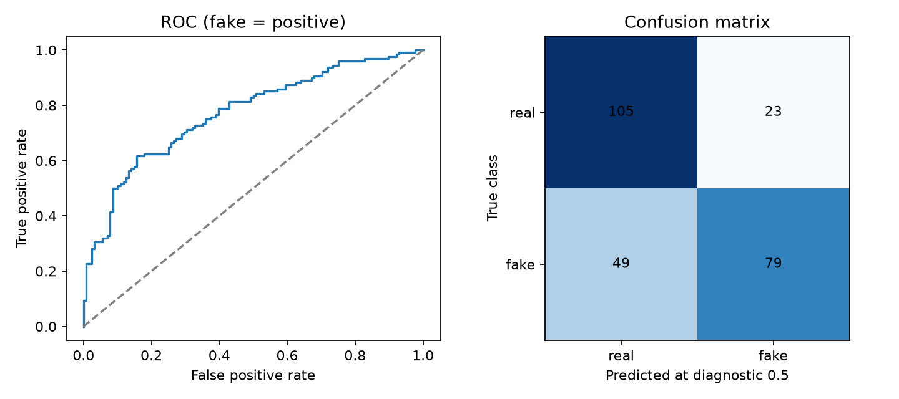

# Experimental Arabic head adaptation — 20 October 2026

On a fresh balanced **256-clip public ArAD subset**, replacing only the final
classifier improved accuracy from **54.69% to 71.88%** at the fixed diagnostic
0.5 cutoff: **44 additional correct decisions**, a gain of 17.19 percentage points.
This is a clip-level exploratory result, not proof of performance on new speakers.

The subset excludes all 128 clips in the earlier reviewed benchmark. Compare
models within this new paired subset; the earlier 62.50% result used different
clips. We did not fit weights or select thresholds using these confirmation clips.

## Confirmation results

| Metric | Original classifier | Adapted classifier |
|---|---:|---:|
| Accuracy | 54.69% | 71.88% |
| Fake precision | 57.32% | 77.45% |
| Fake recall | 36.72% | 61.72% |
| F1 | 44.76% | 68.70% |
| Interpolated EER | 47.66% | 29.69% |

Baseline confusion matrix (rows true real/fake, columns predicted real/fake): `[[93, 35], [81, 47]]`.

Adapted confusion matrix (rows true real/fake, columns predicted real/fake): `[[105, 23], [49, 79]]`.

The adapted classifier corrected 62 errors and introduced 18 new errors compared
with the original, for a net 44 corrections. It still missed **49 of 128 labeled
fake clips** and falsely flagged **23 of 128 real clips**. This remains experimental.

## Digital robustness: same balanced 16-clip subset

| Condition | Original accuracy | Adapted accuracy |
|---|---:|---:|
| original | 43.75% | 75.00% |
| resampled_8khz | 43.75% | 68.75% |
| noise_20db | 50.00% | 81.25% |
| noise_10db | 50.00% | 81.25% |
| mp3_32kbps | 43.75% | 62.50% |

Every tested perturbation passed the predefined non-regression check on this
small subset. The original condition here has **16 clips**, not 256. The sample
is too small to establish robust performance in general. No physical speaker /
microphone re-recording was performed.

## What was trained and reserved

- Source: [ArAD / DeepFake-Audio-Rangers](https://huggingface.co/datasets/DeepFake-Audio-Rangers/Arabic_Audio_Deepfake),
  revision `9dbe1c09acc5907741dcd8c64d7a1d092ff1886d`, stated
  [ODC-By-1.0](https://opendatacommons.org/licenses/by/1-0/) license.
- Frozen encoder and projector: Gary A. Stafford's
  [wav2vec2-deepfake-voice-detector](https://huggingface.co/garystafford/wav2vec2-deepfake-voice-detector),
  revision `c66306024a7ede0be291e9c4558b37634782dc4e`, stated Apache-2.0 license.
- Training: 128 real + 128 fake clips from the publisher training partition,
  excluding development recordings and exact matches with the entire test split.
  Original, 20 dB noise and MP3 variants yield **768 training feature vectors**.
- Development: reserved 32 real + 32 fake training-partition clips, used for a
  predefined pass/fail check. Accuracy was **62.50% versus 73.44%**, fake recall
  **46.88% versus 68.75%**, and real recall **78.13% for both**.
- Fitting: fixed logistic regression `C=0.1`, standardized features, balanced class
  weights. Scaling is folded into 256 numeric classifier weights and one bias.
  The encoder and projector were not fine-tuned. No production abstention
  thresholds or new risk bands were fitted.
- Confirmation: 128 real + 128 fake previously unreviewed publisher test clips,
  seed 20261021, with the fitted head checksum frozen before testing.
- All stages use exact-byte clip checksums and immutable source revisions. No
  source audio or extracted voice features are committed.

The head passed the frozen development and confirmation accuracy/recall criteria
and the confirmation perturbation checks. It is offered as an **opt-in profile**;
the general default classifier is unchanged. It replaces the existing linear
layer with another of the same dimensions, so it adds no second encoder pass.
This architecture comparison is not a measured laptop latency guarantee.

## Rejected alternative

Before adaptation, one predefined multilingual XLS-R candidate was compared on
only the development clips. It achieved 67.19% accuracy versus the baseline's
62.50%, but fake recall fell from 46.88% to 40.63%. It failed the predefined
criteria and never opened the fresh confirmation subset. Its results and
protocol remain in [xlsr/development.json](xlsr/development.json).

## Limits and software evidence

Publisher labels were not independently verified. Speaker IDs, speaker consent
records and source utterance IDs are absent. Byte-level separation cannot prove
speaker independence or absence of semantically duplicated utterances. Overlap
with pretrained detector training data is unverified. The dataset is mainly
Levantine speech, RVC-generated fakes and short cleaned clips; these results do
not establish performance for other dialects, generators, speakers or long audio.

Classifier metrics are **before API speech gating and abstention**. They are
not end-to-end service accuracy, nor probabilities that a recording is authentic.
A proper consented speaker-disjoint study, calibrated abstention and physical
re-recording results are still pending. The exact silent microphone clip from
the user's earlier screenshot remains needed for reproduction.

The software suite passed 58 tests. After the final API metadata addition, all
35 related API, head and engine tests passed. The saved head's installed runtime
scores were checked against offline scores; mismatched models/labels, invalid
weights and stale calibration are rejected. Medium/high Bandit scanning passed.

## Reproduce or use

See [the protocol](../../MODEL_IMPROVEMENT.md) for all study steps and
[Windows launch instructions](../../ARABIC_PROFILE.md) to use the packaged profile.
Raw evidence: [fit](head/fit.json), [confirmation](head/confirmation.json),
[training selection](head/train-selection.json), and
[confirmation selection](head/confirmation-selection.json).
The saved classifier checksum in those reports matches the packaged JSON head.
